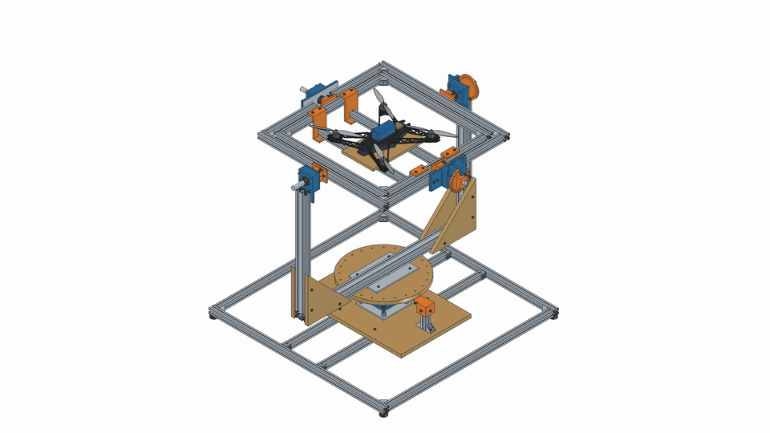

# Aerolith Drone Bench

Banc manuel de calibration IMU à trois axes pour un drone LithFrame F380 de 2 kg.

[Banc : CAO, plans, STL et composants](outputs/banc/README.md)

[Châssis CNC : carbone 4 mm, fraise Ø3 mm](outputs/chassis/README.md)

