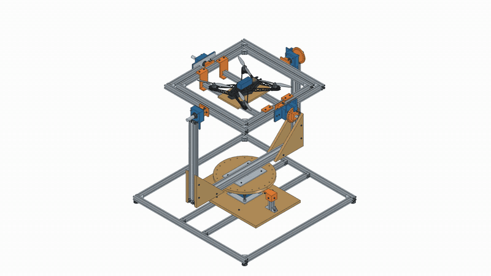
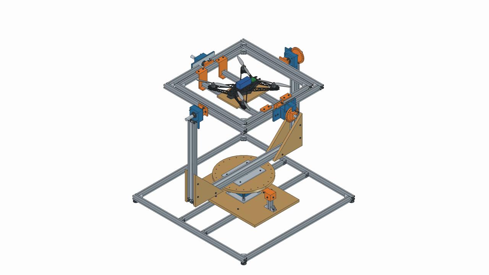
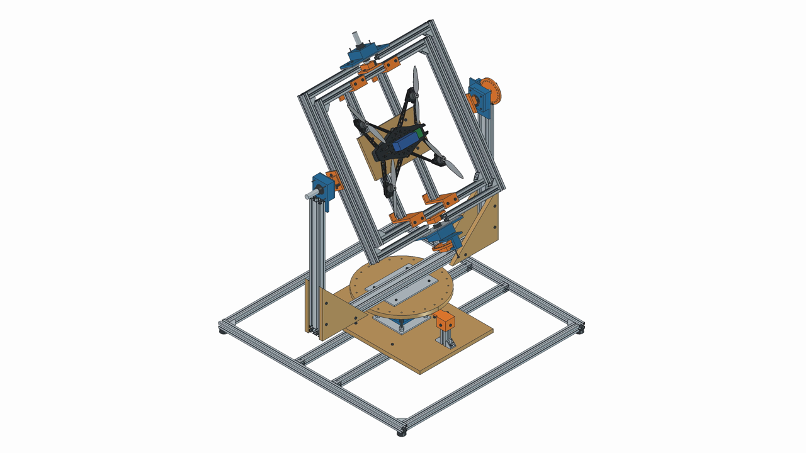
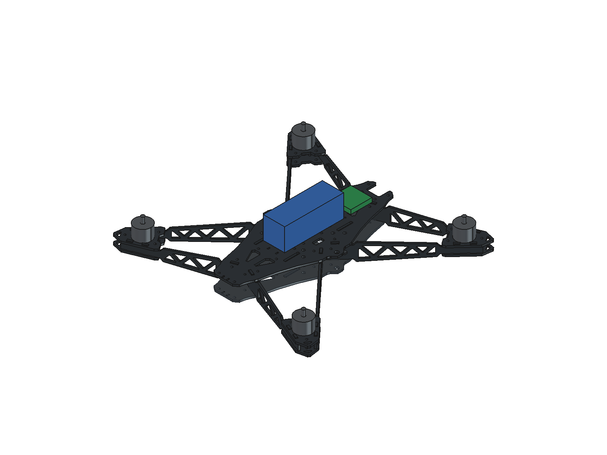
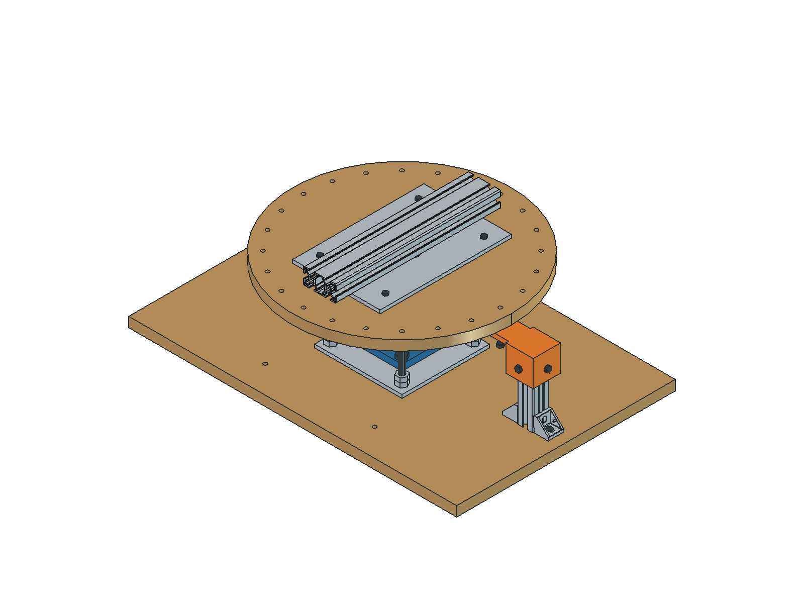

# Aerolith Drone Bench

Banc manuel de calibration IMU à trois axes pour drone LithFrame F380. Projet FreeCAD conçu autour d'un drone complet de **2 kg**, avec profilés aluminium, visserie standard et pièces PETG imprimables sur **220 × 220 mm**.

## Animation

Lacet, tangage, roulis, puis mouvement combiné — 12 secondes, sans texte ni son. Le GIF s'affiche directement sur cette page.

[Voir ou télécharger la vidéo 4K — 3840 × 2160, 24 images/s](outputs/V5_Helices_4K/Banc_IMU_Helices_4K.mp4)

## Vues du projet

| Banc complet avec drone et hélices — V5 | Cadre en position inclinée — V5 |
|---|---|
|  |  |

| Assemblage des pièces carbone du drone — V4, sans hélices | Détail du pivot de lacet — V3, conservé dans V5 |
|---|---|
|  |  |

## Liste des composants du banc

Quantités montées. Les kits d'équerres et leur visserie sont distingués de la visserie supplémentaire dans la nomenclature complète.

| Composant | Quantité / dimensions |
|---|---|
| Profilés aluminium 3030, Type B rainure 8 | 19 coupes — 11,888 m |
| Profilés aluminium 3060, Type B rainure 8 | 3 coupes — 2,150 m |
| Équerres 30 B8 avec kits de fixation | 26 |
| Roulements 6004-2RS | 8 — 20 × 42 × 12 mm |
| Paliers à bride UCF204 | 2 — arbre Ø20, entraxe 64 mm |
| Butée à billes 51104 | 1 — 20 × 35 × 10 mm |
| Support d'arbre SHF20 | 1 — entraxe 47,5 mm |
| Arbres lisses acier Ø20 | 4 × 150 mm + 1 × 200 mm |
| Bagues d'arrêt DIN 705 | 9 — 20 × 32 × 14 mm |
| Rondelles de réglage DIN 988 | 16 — 20 × 28 × 1 mm |
| Entretoises métalliques | 4 pour M4, L20 + 4 alésage Ø8,5, L12 mm |
| Pièces de contreplaqué bouleau | 7 — goussets, support drone, socle et disque |
| Plaques aluminium | 6 — 2 en épaisseur 3 mm + 4 en épaisseur 6 mm |
| Patins caoutchouc | 4 |
| Pièces PETG montées | 25, réparties sur 10 formes |
| Coupon d'ajustement + gabarit | 2 impressions supplémentaires |
| Visserie et tirants | M4, M5, M6, M8, M10 ; détail dans la nomenclature |

[Liste complète : longueurs de coupe, pièces plates, visserie et quantités d'impression](outputs/V5_Helices_4K/Liste_materiel_V5.md) · [Télécharger le CSV pour Excel](outputs/V5_Helices_4K/Liste_materiel_V5.csv)

Longueurs de coupe des profilés

| Section — Type B rainure 8 | Longueur finie (mm) | Quantité |
|---|---:|---:|
| 3030 | 120 | 1 |
| 3030 | 280 | 4 |
| 3030 | 544 | 2 |
| 3030 | 560 | 2 |
| 3030 | 620 | 2 |
| 3030 | 720 | 2 |
| 3030 | 940 | 4 |
| 3030 | 1000 | 2 |
| 3060 | 600 | 2 |
| 3060 | 950 | 1 |

Longueurs finies : ajouter les traits de scie pour l'achat en barres.

Le drone représenté comporte deux platines centrales, quatre bras courts, quatre bras longs et huit socles moteurs issus des DXF. Les quatre moteurs, la batterie, le contrôleur et les quatre hélices de 9 pouces sont des représentations indicatives ; leurs références réelles restent à préciser. Ils ne sont pas inclus dans les achats du banc.

## Fichiers à télécharger

| Fichier | Contenu |
|---|---|
| [CAO FreeCAD V5](outputs/V5_Helices_4K/Banc_IMU_V5_Helices.FCStd) | Banc et drone assemblé avec hélices |
| [Assemblage STEP V5](outputs/V5_Helices_4K/Banc_IMU_V5_Helices.step) | Échange avec d'autres logiciels de CAO |
| [Pièces STL](outputs/V3_Pivot_lacet/STL/) | 12 formes : 25 pièces montées, coupon et gabarit |
| [Notice du pivot de lacet](outputs/V3_Pivot_lacet/Notice_pivot_V3.md) | Montage de la cartouche et indexage |
| [Plans DXF du pivot](outputs/V3_Pivot_lacet/Plans_pivot_V3.dxf) | Perçages des plaques et panneaux du pivot |
| [Guide des parties hautes](outputs/V3_Pivot_lacet/Guide_V2_parties_conservees.md) | Fourche, cadres et fixation du drone ; appliquer le pivot V3 |
| [Plans des pièces plates V2](outputs/V2_Amateur_2kg/Plans_percage_bois_et_ponts.dxf) | Goussets CP03, platine CP04 et ponts AL01 ; anciens CP01/CP02 remplacés en V3 |
| [DXF originaux LithFrame](outputs/Sources_LithFrame/) | Pièces carbone fournies |

La nomenclature V5 consolide les achats des parties hautes V2 et du pivot V3. Les versions précédentes restent disponibles pour les sources et les étapes de conception ; leurs listes d'achat ne doivent pas être additionnées.

## Utilisation dans FreeCAD

Ouvrir le fichier V5. Les cellules **B4, B5 et B6** du tableau `Parametres` pilotent respectivement le lacet, le tangage et le roulis.

Usage prévu : calibration manuelle statique, **hélices retirées sur le drone réel**. Les contrôles géométriques ne constituent pas une validation de résistance ni une validation d'essais de poussée moteur.

Les scripts de construction, de rendu et de nomenclature sont conservés dans `work/`. Certains utilisent les chemins Windows et la connexion RPC FreeCAD de l'environnement de création ; les adapter avant exécution sur un autre poste. Les fichiers CAO livrés s'ouvrent directement.

Illustration initiale du dépôt

