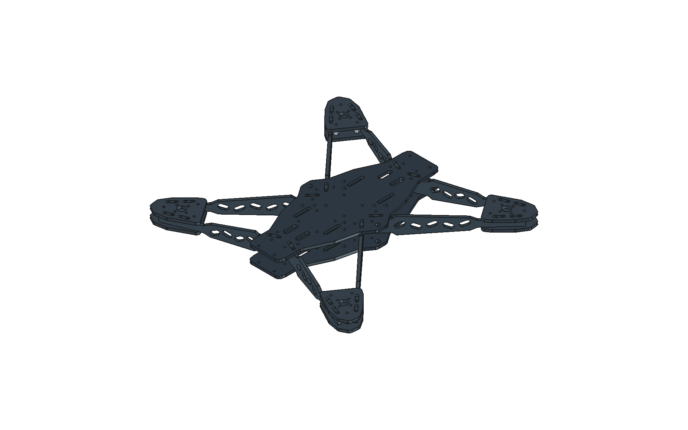

# Aerolith — Châssis CNC R1

Nouveau projet FreeCAD autonome, distinct du banc et du châssis original. Base de fabrication retenue : **carbone de 4 mm, fraise Ø3 mm**, conformément aux dimensions données. Assemblage à huit bras sur chant, deux platines centrales et quatre supports moteurs doubles.

## Fichiers

- [Projet FreeCAD](Aerolith_Chassis_CNC_R1.FCStd)
- [Assemblage STEP](STEP/Aerolith_Chassis_CNC_R1_assemble.step)
- [Pièces et planche DXF à l'échelle 1:1](DXF/)
- [Vue des pièces à plat](Chassis_CNC_R1_pieces.png)
- [Nomenclature CSV](Nomenclature_chassis_CNC.csv)
- [Vérifications géométriques](verification_CNC.json)

## Changements de conception

- Contours extérieurs des platines et supports moteurs arrondis. La platine centrale mesure 128 × 270 mm ; les bras conservent leurs longueurs de 160 et 190 mm.
- Ajours triangulaires et petits détails décoratifs remplacés par des lumières oblongues. Les logos découpés et le motif électronique M2 à trous Ø2,2 ne sont plus usinés dans cette version.
- Rayons de raccordement aux épaulements des bras : 1,6 mm ; extrémités convexes des tenons arrondies à 1 mm. Un rayon extérieur peut être inférieur au rayon de la fraise ; les angles rentrants doivent laisser passer l'outil.
- Rainures élargies à **4,2 mm**, soit un jeu nominal total de 0,2 mm pour une plaque de 4 mm. Leur allongement dégage les raccordements des tenons : **17,6 × 4,2 mm** dans les platines centrales et **15,6 × 4,2 mm** dans les supports moteurs. Elles évitent d'exiger un angle intérieur vif.
- Centres des rainures, entraxes principaux de la base et centres de fixation des moteurs conservés. Les petits trous Ø3,2 sont portés à Ø3,3. Les trous Ø4,5, Ø6,5 et le dégagement moteur Ø12 restent conservés.
- Les ouvertures de sangles mesurent 27 × 5 mm. Les zones de passage et les ajours ont été réorganisés avec des transitions arrondies.
- Entretoises représentées : quatre M3 de longueur 20 mm au centre et trois M3 de longueur 10 mm à chaque station moteur. Leur fixation et les longueurs de vis restent à confirmer avec les composants achetés.

La somme des longueurs des contours nominaux des 18 pièces carbone passe d'environ **13,81 m à 11,99 m**, soit **13,2 % de moins**. Ce chiffre exclut compensation, entrées, ponts, passes en profondeur et déplacements ; il ne prédit pas le temps machine.

À épaisseur égale de 4 mm, le volume de carbone augmente d'environ **13,8 %** par rapport aux profils originaux. Cette révision conserve davantage de matière et simplifie les découpes ; elle ne revendique pas un allègement ni une résistance calculée supérieure. Le volume total des 18 pièces carbone est d'environ 321 cm³. Aucune masse de drone complet n'est déduite de ces seuls volumes.

## Quantités à découper

| Pièce | Quantité | Dimensions hors tout, mm |
|---|---:|---|
| Platine centrale | 2 | 128 × 270 × 4 |
| Bras court | 4 | 160 × 28 × 4 |
| Bras long | 4 | 190 × 28 × 4 |
| Socle moteur | 8 | 50,32 × 64,32 × 4 |
| Coupon d'ajustement | 1 | 84 × 32 × 4 |

Le fichier `DXF/Planche_600x600_quantites_completes.dxf` rassemble les **18 pièces + 1 coupon** sur une référence de plaque de 600 × 600 mm. L'espacement minimal entre contours de pièces est de 10,679 mm. Il s'agit d'une implantation géométrique, à adapter au bridage et aux ponts de maintien ; ce n'est pas une optimisation matière.

## Préparation de l'usinage

1. Mesurer la plaque réelle. Tester le coupon avant les pièces définitives : vue de dessus, les six rainures de gauche à droite font **4,00 / 4,10 / 4,20 / 4,30 / 4,40 / 4,50 mm**. Utiliser une chute de la plaque de 4 mm pour choisir le jeu, sans forcer.
2. Les DXF sont en **millimètres, contours nominaux de la pièce**, avec arcs circulaires analytiques. Ils ne représentent pas le centre de l'outil. Régler la compensation dans le logiciel de FAO.
3. Usiner uniquement le calque `DECOUPE`. Les calques `ANNOTATIONS_NE_PAS_USINER` et `PLAQUE_REFERENCE` servent à la lecture et au placement. Ne pas les convertir en parcours.
4. Définir les entrées, l'ordre des découpes, les passes, les ponts, le bridage et les paramètres de coupe dans la FAO avec l'atelier. Les trous Ø3,3 ont un faible jeu par rapport à une fraise Ø3 ; valider leur diamètre réel par essai.
5. Contrôler les ajustements et la fermeture des deux platines avant de monter les équipements. Le châssis de 4 mm n'est pas interchangeable pièce par pièce avec l'ancien jeu de plaques de 3 mm : utiliser les bras et rainures R1 ensemble.

**Aucun G-code n'est fourni.** Le châssis reste un prototype à valider, pas une définition de production approuvée.

## Points restant à confirmer

- Le dégagement moteur Ø12 et les quatre trous sur le cercle de fixation source laissent localement **1,85 mm de matière** entre alésage et trous. Cette géométrie de fixation conservée demande une vérification avec le moteur réel et les efforts attendus ; les 4 mm d'épaisseur ne constituent pas une justification de résistance.
- L'épaisseur exacte, la structure du stratifié, la fraise réelle et son faux-rond conditionnent l'ajustement. Le jeu de 0,2 mm est une valeur d'essai, pas une tolérance garantie.
- Les moteurs, l'électronique, les hélices et la batterie ne sont pas définis dans ce projet de châssis. Confirmer leurs dimensions, passages, fixations et visserie avant fabrication finale.
- L'objectif de drone complet de 2 kg n'a pas fait l'objet d'un calcul structurel ni d'un essai. La vérification géométrique ne remplace pas ces validations.

## Vérifications réalisées

- Cinq formes planes fermées et cinq extrusions solides valides.
- Aucune interférence volumique entre les 18 pièces carbone assemblées.
- Réouverture du fichier FreeCAD et validité de ses extrusions et liens.
- Réimport indépendant des DXF : contours fermés, faces valides et aires identiques à moins de 0,001 mm² sur les valeurs arrondies du rapport.
- Implantation des 19 pièces dans 600 × 600 mm, sans superposition.

Les plus petits ligaments géométriques sont d'environ 3,35 mm sur la platine, 3,39 mm sur le bras court, 3,12 mm sur le bras long et 1,85 mm sur le support moteur. Il s'agit de distances géométriques ; elles ne définissent pas une résistance admissible.

## Modifier le projet

Le document comporte une bibliothèque de profils et des extrusions FreeCAD, un assemblage de liens et une vue des pièces à plat. Les paramètres du tableau sont des références documentaires : **ils ne recalculent pas automatiquement les rainures**.

Pour reconstruire l'ensemble, ouvrir `Construire_chassis_CNC.FCMacro` dans FreeCAD et modifier les constantes puis exécuter la macro. Conserver `Sources/contours_source.json` à côté de la macro dans son sous-dossier. Le diamètre Ø3 et l'épaisseur 4 mm sont les seules valeurs vérifiées dans cette livraison ; une modification impose un nouveau contrôle des interfaces.

La macro génère le document, les STEP, les vues et `contours_CNC.json`. Pour recréer ensuite les DXF, exécuter `Exporter_DXF.py` avec Python et le module `ezdxf`. L'implantation de planche doit être revue si les dimensions changent.

## Principes de fabrication utilisés

Les angles intérieurs usinés sont limités par le rayon de la fraise ; les dégagements doivent être prévus aux emboîtements. Voir les explications de [Protolabs sur la conception pour l'usinage CNC](https://www.hubs.com/knowledge-base/how-design-parts-cnc-machining/) et de [SendCutSend sur les procédés de découpe et les dégagements d'angles](https://sendcutsend.com/blog/laser-cutting-waterjet-cutting-cnc-routing-how-we-choose-the-perfect-cut-for-your-part/). Les rayons et ajustements de cette R1 sont des choix de conception propres au projet.
